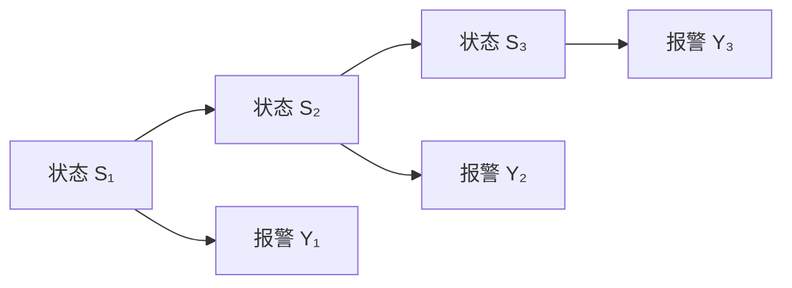

# 04 贯穿例子：设备状态与报警

> 目标：用可以手算的模型串起先验、转移、观测与后验。以下参数是教学设定，不是现实设备统计。

## 1. 定义变量与模型

$S_t\in\{N,F\}$：正常 Normal、故障 Fault。$Y_t\in\{0,1\}$：不报警、报警。隐藏的是设备真实状态，能看到的是报警记录。

初始分布为 $P(S_1=N)=0.9$，$P(S_1=F)=0.1$。转移矩阵的**行是原状态，列是新状态**：

| 上一步 → 下一步 | $N$ | $F$ |
|---|---:|---:|
| $N$ | 0.95 | 0.05 |
| $F$ | 0.20 | 0.80 |

发射 emission / 观测概率：

| 状态 | 不报警 $Y=0$ | 报警 $Y=1$ |
|---|---:|---:|
| $N$ | 0.90 | 0.10 |
| $F$ | 0.20 | 0.80 |

所以正常设备也有 10% 的报警概率，故障设备也可能不报警。故障具有持续性，但不必永久持续。

联合分布是：

$$P(s_{1:T},y_{1:T})=\pi(s_1)b_{s_1}(y_1)\prod_{t=2}^{T}a_{s_{t-1},s_t}b_{s_t}(y_t).$$

其中 $a_{ij}=P(S_t=j\mid S_{t-1}=i)$，$b_j(y)=P(Y_t=y\mid S_t=j)$。

## 2. 第一天报警：先乘，再除

已知 $y_1=1$。两种解释的未归一化权重：

$$w_N=0.9\times0.1=0.09,\qquad w_F=0.1\times0.8=0.08.$$

报警的总概率 $P(y_1=1)=0.17$，所以：

$$P(S_1=F\mid y_1=1)=\frac{0.08}{0.17}\approx0.470588.$$

虽然故障状态下报警概率是 0.8，但一次报警后故障概率仅约 47.1%。正常设备本来多，所以误报的贡献不能忽略。

## 3. 第二天观测前：先做一步预测

已经知道第一天后验，预测第二天故障概率：

$$P(S_2=F\mid y_1)=\frac{9}{17}\times0.05+\frac{8}{17}\times0.80
=\frac{6.85}{17}\approx0.402941.$$

为什么从 47.1% 降到 40.3%？因为状态转移允许部分故障恢复，同时有少量正常设备新发故障。预测不是简单复制昨天的后验。

## 4. 第二天也报警：再做观测更新

未归一化概率为：

$$w_N=0.597059\times0.1\approx0.059706,$$
$$w_F=0.402941\times0.8\approx0.322353.$$

归一化后：

$$P(S_2=F\mid y_1=1,y_2=1)=\frac{0.322353}{0.382059}\approx0.843726.$$

连续两次报警后，当前故障的判断变为约 84.4%。这展示了过滤的完整循环：**旧后验 → 转移预测 → 乘观测似然 → 归一化**。

本次第二个报警的条件概率是 $c_2=P(y_2=1\mid y_1=1)\approx0.382059$；整段报警序列概率是 $c_1c_2=0.17\times0.382059=0.06495$。

## 5. 回头看第一天：这是平滑

第二天的报警还会改变我们对第一天的判断。若第一天正常，第二天报警概率为：

$$0.95\times0.1+0.05\times0.8=0.135.$$

若第一天故障，第二天报警概率为：

$$0.20\times0.1+0.80\times0.8=0.66.$$

所以：

$$P(S_1=F\mid y_1=1,y_2=1)=\frac{0.08\times0.66}{0.09\times0.135+0.08\times0.66}
\approx0.812933.$$

第一天“当时的判断”约 47.1%，第二天回看第一天则约 81.3%。二者使用的信息不同，不能拿后者冒充第一天已经知道的结果。

## 6. 扩成真正的多状态分量 DBN

添加传感器健康 $H_t$ 和工况 $W_t$，可设计为：

$$P(W_t\mid W_{t-1})P(S_t\mid S_{t-1},W_t)
P(H_t\mid H_{t-1})P(Y_t\mid S_t,H_t).$$

这时报警可能由设备故障或传感器异常解释。给定报警后，$S_t,H_t$ 的后验一般相关：越确信传感器坏了，越不必用设备坏来解释报警。它把 [[01 概率与贝叶斯网络基础|碰撞点]] 与 [[06 精确推断、接口与计算复杂度|信念纠缠]] 接了起来。

本库的手算继续使用两状态简版，以便把每一步算清楚。简版是 HMM，也是 DBN 的特例；不要据此误以为所有 DBN 只有一个状态节点。

## 自检与讨论

1. 第二天如果没有报警，当前故障概率是多少？先写权重，再算数值。
2. 将误报率从 0.10 降到 0.01，第一次报警为什么会更有说服力？
3. 报警是否会反过来改变真实设备？在当前图里，这个过程有没有被表示？

可对 ChatGPT 说：“沿用这篇的参数，让我手算第三天的预测与更新。每一步只提示我该求和还是相乘，不要直接给最终值。”

上一节 [[03 DBN、两时间片模板与展开]] · 下一节 [[05 过滤、预测、平滑与解码]]
