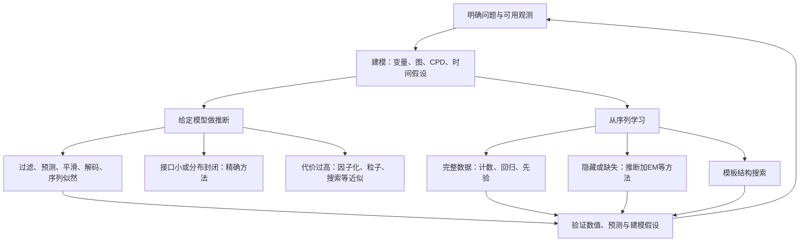

# 15 统一知识地图与术语索引

> 这一篇用于读过之后回忆和查找。第一次学习请从 [[01 概率与贝叶斯网络基础]] 顺着走，不必先背术语。

## 1. 把所有问题放回同一张图

建模决定允许哪些分布；推断在已给模型里算后验；学习选择参数或结构；验证检查这些选择是否回答了原问题。四个环节不能互相替代。

## 2. 所有算法的共同接口

旧信念与当前因子组合，得到新的信念。精确离散算法保留概率表，高斯算法保留均值和协方差，因子化方法保留边缘或区域消息，粒子方法保留带权样本，搜索方法保留候选轨迹。

这回答“信息用什么表示”。另一个问题是“合并解释时求和还是取最大”：前者累计概率质量，后者寻找最优解释。表示方法与计算目标是两个维度。

## 3. 从模型条件选择起点

| 已知条件 | 可以先考虑 | 再检查什么 |
|---|---|---|
| 小型离散状态 | HMM 前向后向／精确消元 | 联合状态数与接口宽度 |
| 多变量、弱依赖 | 因子化信念或分组消息 | 被丢弃相关性对目标是否重要 |
| 线性高斯 | Kalman filter / smoother | 高斯、线性、噪声独立是否合理 |
| 温和非线性、近似单峰 | EKF / UKF | 局部近似与不确定性是否失真 |
| 强非线性或多峰 | Particle filter | 提议、维数、退化与计算预算 |
| 部分状态可解析 | Rao–Blackwellized PF | 条件子问题是否长期可处理 |
| 只需少量高概率路径 | Viterbi 或受限搜索 | 是精确解码还是有剪枝的近似 |
| 隐状态、参数未知 | EM／其他观测似然优化 | E-step 质量、初始化、可识别性 |

这些是起点，不是“符合一行就一定最优”的规则。用小模型和真实任务指标比较后再决定。

## 4. 符号速查

| 符号 | 含义 |
|---|---|
| $S_t,x_t$ | 当前隐状态；大写常用于随机变量，小写也常用于连续状态向量 |
| $Y_t,y_t$ | 观测变量及实际观测 |
| $s_{1:T}$ | 一条完整状态轨迹 |
| $\pi,A,B$ | 离散初始分布、转移矩阵、观测表 |
| $b_t,f_t$ | 归一化过滤信念，本库两种记号在各篇内定义 |
| $b_j(y)$ | 状态 $j$ 的观测概率或密度，别与 $b_t$ 混淆 |
| $\alpha,\beta$ | HMM 前向、后向消息 |
| $\gamma,\xi$ | 单时刻、相邻两时刻平滑后验 |
| $c_t$ | 一步观测预测概率或密度／缩放因子 |
| $Q,R$ | Kalman 过程噪声与观测噪声协方差 |
| $Q(\theta\mid\theta^{old})$ | EM 的期望完整数据目标，与噪声矩阵 $Q$ 无关 |
| $\theta,\ell$ | 参数、对数似然 |

符号可以被不同作者复用，阅读时先查本节定义；字母本身没有固定不变的物理含义。

## 5. 术语索引

| 术语 | 去哪里理解 |
|---|---|
| CPD/CPT、DAG、d-separation、explaining away | [[01 概率与贝叶斯网络基础]] |
| time slice、Markov、齐次、状态扩充、semi-Markov | [[02 时间、状态与建模假设]] |
| 2-TBN、initial network、unrolling、interface、persistence | [[03 DBN、两时间片模板与展开]] |
| filtering、prediction、smoothing、MAP trajectory | [[05 过滤、预测、平滑与解码]] |
| variable elimination、clique tree、treewidth、entanglement | [[06 精确推断、接口与计算复杂度]] |
| forward–backward、Viterbi、log-sum-exp、软计数 | [[07 HMM与前向后向算法]] |
| factored belief、projection、ADF、EP、beam search | [[08 近似推断与因子化信念]] |
| SMC、proposal、importance weight、ESS、RBPF | [[09 粒子滤波与序贯蒙特卡洛]] |
| LDS、Kalman、innovation、EKF、UKF、CLG、switching | [[10 连续状态、Kalman与混合DBN]] |
| MLE、MAP、Dirichlet、parameter tying | [[11 参数学习与参数共享]] |
| EM、Baum–Welch、MAR/MNAR、identifiability | [[12 隐状态、缺失数据与EM]] |
| score/constraint-based、BIC、structural EM、do、Granger | [[13 结构学习与因果边界]] |
| leakage、calibration、predictive likelihood、残差诊断 | [[14 实践流程、评估与诊断]] |

## 6. 综合复述题

尝试不看正文，用设备例子连续回答：

1. 为什么真实状态与观测要分开，哪些假设让模板可以重复使用？
2. 如何从模板得到联合分布，从联合分布得到过滤递推？
3. 为什么同样一张稀疏图，当前后验可能很难表示？
4. 精确、因子化、高斯和粒子方法分别保留了什么信息？
5. 参数未知而状态隐藏时，推断和学习怎样相互配合？
6. 预测有效还不能说明什么？怎样设计一次不泄漏的验证？

能完整说清主线后，再选择原书推导、算法实现或自己的研究数据深入，不必把所有扩展同时学完。

上一节 [[14 实践流程、评估与诊断]] · [[00 从这里开始|返回首页]]
